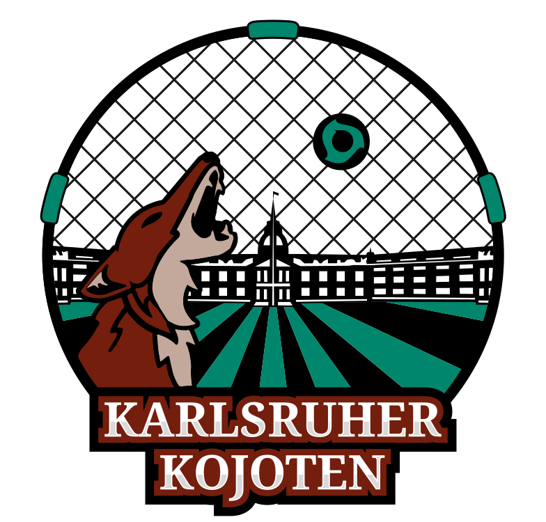

<br/>
<p align="center">
  <a>
    
  </a>

  <h2 align="center">Roundnet Karlsruhe Web App</h2>

  <p align="center">
    Multi-tenant Progressive Web Application for managing Roundnet community events, drinks, and games
    <br/>
    <br/>
    <br/>
    <p align="center">
      <a href="https://roundnet-karlsruhe.web.app">🌐 Karlsruhe Production</a>
      ·
      <a href="https://munich-roundnet.web.app">🌐 Munich Production</a>
      ·
      <a href="https://staging-roundnet-karlsruhe.web.app">🧪 Staging</a>
      ·
      <a href="https://github.com/risingwolf21/roundnet_karlsruhe_app/issues">🐛 Report Bug</a>
    </p>
  </p>
</p>

[](https://github.com/risingwolf21/roundnet_karlsruhe_app/actions/workflows/firebase_deployment.yml) [](https://github.com/risingwolf21/roundnet_karlsruhe_app/actions/workflows/react_build_deploy_staging.yml) [](https://github.com/risingwolf21/roundnet_karlsruhe_app/actions/workflows/supabase_production_backup.yml)

## 📋 Table of Contents

- [Overview](#overview)
- [Tech Stack](#tech-stack)
- [Getting Started](#getting-started)
- [Environment Configuration](#environment-configuration)
- [Available Scripts](#available-scripts)
- [Development Workflow](#development-workflow)
- [Deployment](#deployment)
- [Database Management](#database-management)
- [Project Structure](#project-structure)
- [Contributing](#contributing)

## 🎯 Overview

This is a modern Progressive Web Application (PWA) designed for managing Roundnet communities. It supports multiple tenants (Karlsruhe and Munich) with dedicated databases and configurations. The application enables community management, event organization, game tracking, drink/payment tracking, and user administration.

### Key Features

- **Multi-tenant architecture** - Separate deployments for Karlsruhe and Munich
- **Progressive Web App** - Installable, offline-capable, mobile-first design
- **Event Management** - Create, manage, and track community events
- **Game Tracking** - Record and analyze game statistics
- **Payment System** - Track drinks and payments within the community
- **User Management** - Role-based access control and user profiles
- **Internationalization** - Multi-language support (i18next)
- **Real-time Updates** - Powered by Supabase realtime subscriptions
- **Error Tracking** - Integrated Sentry monitoring

## 🛠 Tech Stack

### Frontend
- **React 19.0** - UI framework
- **TypeScript 5.9** - Type-safe development
- **Material-UI v7** - Component library (@mui/material, @mui/icons-material, @toolpad/core)
- **Vite 7.1** - Build tool and dev server
- **React Router 7.9** - Client-side routing
- **TanStack Query 5.90** - Data fetching and state management
- **i18next** - Internationalization
- **Leaflet** - Interactive maps
- **date-fns** - Date manipulation

### Backend & Database
- **Supabase** - Backend-as-a-Service (PostgreSQL, Auth, Storage, Edge Functions)
- **Supabase Edge Functions** - Serverless functions (Deno)
- **PostgreSQL** - Relational database with schemas: public, games, audit, notifications, util

### Infrastructure
- **Firebase Hosting** - Multi-site hosting (Karlsruhe, Munich, Staging)
- **GitHub Actions** - CI/CD pipelines
- **Sentry** - Error tracking and monitoring
- **Workbox** - Service Worker and offline capabilities

### Developer Tools
- **ESLint 9** - Linting
- **Prettier** - Code formatting
- **Yarn** - Package management

## 🚀 Getting Started

### Prerequisites

- **Node.js** (v18 or higher) - [Download](https://nodejs.org/en/download)
- **Yarn** (Classic 1.x) - [Installation Guide](https://classic.yarnpkg.com/lang/en/docs/install/)
- **Supabase CLI** (for database work) - [Installation Guide](https://supabase.com/docs/guides/cli)

### Installation

1. **Clone the repository**
   ```bash
   git clone https://github.com/risingwolf21/roundnet_karlsruhe_app.git
   cd roundnet_karlsruhe_app
   ```

2. **Install dependencies**
   ```bash
   yarn install
   ```

3. **Set up environment variables**
   
   Create local environment files in the `environments/` directory:
   - `.env.local` - Local development base config
   - `.env.staging.local` - Staging environment credentials
   - `.env.karlsruhe.local` - Karlsruhe production credentials
   - `.env.munich.local` - Munich production credentials
   - `.env.production.local` - Production credentials

   See [Environment Configuration](#environment-configuration) for details.

4. **Start the development server**
   ```bash
   yarn start
   ```

5. **Open your browser**
   
   Navigate to [http://localhost:5173](http://localhost:5173)

## ⚙️ Environment Configuration

The application uses environment-specific configurations located in the `environments/` directory.

### Environment Files

- `.env` - Base configuration
- `.env.staging` - Staging environment
- `.env.karlsruhe` - Karlsruhe tenant config
- `.env.munich` - Munich tenant config
- `.env.*.local` - Local overrides (credentials, API keys) - **NOT committed to git**

### Key Environment Variables

```bash
# Supabase
VITE_SUPABASE_URL=https://your-project.supabase.co
VITE_SUPABASE_ANON_KEY=your-anon-key
SUPABASE_PROJECT_ID=your-project-id

# App Configuration
VITE_WEBSITE_NAME=App Name
VITE_SHORT_NAME=Short Name
VITE_THEME_COLOR=#0b5fff
VITE_PUBLIC_URL=https://your-domain.web.app/
VITE_ICON_PREFIX=/icons/tenant-name

# Sentry
VITE_SENTRY_DSN=your-sentry-dsn

# Feature Flags
VITE_PWA_DEV=false
```

## 📜 Available Scripts

### Development

```bash
# Start development server (default: staging mode)
yarn start

# Start with Karlsruhe production config
yarn start:rk:prod

# Start with Munich production config
yarn start:mrc:prod

# Start with staging config
yarn start:staging
```

### Building

```bash
# Build for development/default
yarn build

# Build for Karlsruhe production
yarn build:karlsruhe

# Build for Karlsruhe staging
yarn build:karlsruhe-stg

# Build for Munich production
yarn build:munich

# Build with bundle analyzer
yarn analyze
```

### Database & Supabase

```bash
# Generate TypeScript types from production schema
yarn gen-types:production

# Generate TypeScript types from staging schema
yarn gen-types:staging

# Generate TypeScript types from local Supabase
yarn gen-types:local

# Generate custom types
yarn gen-types:custom

# Push database changes to staging
yarn supabase:db:push:staging

# Push database changes to Karlsruhe production
yarn supabase:db:push:rk:prod

# Push database changes to Munich production
yarn supabase:db:push:mrc:prod

# Push to all production databases
yarn supabase:db:push:prod

# Deploy edge functions to production
yarn supabase:func:deploy:prod

# Deploy edge functions to staging
yarn supabase:func:deploy:stag
```

### Code Quality

```bash
# Format code with Prettier
yarn format
```

### Monitoring

```bash
# Upload source maps to Sentry
yarn sentry:sourcemaps
```

## 🔄 Development Workflow

### Local Development with Supabase

1. **Start local Supabase instance**
   ```bash
   npx supabase start
   ```

2. **Create database migrations**
   ```bash
   # Make changes to your local database via Supabase Studio (http://localhost:54323)
   
   # Generate migration file from changes
   npx supabase db diff -f migration_name
   
   # Or create a new migration manually
   npx supabase migration new migration_name
   ```

3. **Generate types after schema changes**
   ```bash
   yarn gen-types:local
   ```

4. **Seed local database**
   ```bash
   # Create seed file from current local data
   npx supabase db dump --local --data-only -f supabase/seed.sql
   
   # Reset and apply seed
   npx supabase db reset
   ```

5. **Export current schema**
   ```bash
   npx supabase db dump --local -f supabase/schema_$(date +%Y_%m_%d).sql
   ```

### Branch Strategy

- `master` - Main development branch
- `production` - Production release branch
- Feature branches - Branch from `master` for new features

### Code Style

- TypeScript strict mode enabled
- ESLint and Prettier configured
- Run `yarn format` before committing
- Commit messages should be descriptive

## 🚢 Deployment

### Environments

The application has three deployment targets:

1. **Staging** - `staging-roundnet-karlsruhe.web.app`
2. **Karlsruhe Production** - `roundnet-karlsruhe.web.app`
3. **Munich Production** - `munich-roundnet.web.app`

### Release Process

> [!IMPORTANT]
> Production deployments are triggered automatically via GitHub Actions when merging to the `production` branch.

1. **Create a Pull Request from `master` to `production`**
   
   [Create PR](https://github.com/risingwolf21/roundnet_karlsruhe_app/compare/production...master)

2. **Review and merge the PR**
   
   The GitHub Actions workflow will automatically:
   - Build the application for both tenants
   - Run tests (if configured)
   - Deploy to Firebase Hosting
   - Upload source maps to Sentry

3. **Monitor deployment**
   
   Check the [Actions tab](https://github.com/risingwolf21/roundnet_karlsruhe_app/actions) for deployment status.

### Manual Deployment

If needed, you can deploy manually using Firebase CLI:

```bash
# Install Firebase CLI
npm install -g firebase-tools

# Login to Firebase
firebase login

# Deploy to staging
firebase deploy --only hosting:staging

# Deploy to Karlsruhe production
firebase deploy --only hosting:production

# Deploy to Munich production
firebase deploy --only hosting:munich-roundnet-production
```

## 🗄 Database Management

### Supabase Schemas

The database is organized into multiple schemas:

- **public** - User profiles, teams, general data
- **games** - Game records, statistics, tournaments
- **audit** - Audit logs, change tracking
- **notifications** - Notification system
- **util** - Utility functions and helpers

### Database Migrations

All migrations are stored in `supabase/migrations/` and are version-controlled.

#### Creating Migrations

```bash
# Generate migration from local database changes
npx supabase db diff -f migration_name

# Create new empty migration
npx supabase migration new migration_name
```

#### Applying Migrations

```bash
# Apply to local database
npx supabase db reset

# Apply to staging
yarn supabase:db:push:staging

# Apply to production (both tenants)
yarn supabase:db:push:prod
```

### Type Generation

After schema changes, regenerate TypeScript types:

```bash
# For local development
yarn gen-types:local

# For staging
yarn gen-types:staging

# For production
yarn gen-types:production
```

Types are generated in `src/types/supabase-generated.types.ts`

### Database Backup

Automatic backups are configured via GitHub Actions (see workflow: `supabase_production_backup.yml`).

Manual backup:

```bash
# Full database dump
npx supabase db dump --local -f backup_$(date +%Y%m%d).sql

# Data only
npx supabase db dump --local --data-only -f seed_$(date +%Y%m%d).sql
```

## 📁 Project Structure

```
roundnet_karlsruhe_app/
├── .github/              # GitHub Actions workflows
├── environments/         # Environment-specific configs (.env files)
├── public/              # Static assets
├── scripts/             # Build and utility scripts
├── src/
│   ├── components/      # Reusable React components
│   ├── features/        # Feature-based modules
│   ├── hooks/           # Custom React hooks
│   ├── lib/             # Third-party library configs
│   ├── repository/      # Data access layer
│   ├── tanstack/        # TanStack Query setup
│   ├── themes/          # MUI theme configurations
│   ├── translation/     # i18next translations
│   ├── types/           # TypeScript type definitions
│   ├── utils/           # Utility functions
│   ├── App.tsx          # Root application component
│   ├── AppRoutes.tsx    # Route definitions
│   ├── index.tsx        # Application entry point
│   └── service-worker.ts # PWA service worker
├── supabase/
│   ├── functions/       # Edge Functions (Deno)
│   ├── migrations/      # Database migrations
│   ├── tests/           # Database tests
│   ├── config.toml      # Supabase local config
│   ├── schema_*.sql     # Schema snapshots
│   └── seed.sql         # Database seed data
├── types/               # Global TypeScript types
├── firebase.json        # Firebase hosting configuration
├── package.json         # Dependencies and scripts
├── tsconfig.json        # TypeScript configuration
├── vite.config.js       # Vite build configuration
└── yarn.lock            # Yarn lock file
```

### Key Directories

- **`src/components/`** - Shared UI components
- **`src/features/`** - Feature modules (events, games, drinks, etc.)
- **`src/repository/`** - Supabase queries and mutations
- **`src/hooks/`** - Custom React hooks
- **`supabase/functions/`** - Serverless edge functions
- **`supabase/migrations/`** - Version-controlled database changes

## 🤝 Contributing

1. Create a feature branch from `master`
   ```bash
   git checkout -b feature/your-feature-name
   ```

2. Make your changes and commit
   ```bash
   git add .
   git commit -m "feat: add your feature"
   ```

3. Format code before pushing
   ```bash
   yarn format
   ```

4. Push and create a Pull Request
   ```bash
   git push origin feature/your-feature-name
   ```

5. Request review and merge to `master`

6. For production releases, merge `master` to `production` branch

## 📝 Additional Resources

- [Supabase Documentation](https://supabase.com/docs)
- [React Documentation](https://react.dev)
- [Material-UI Documentation](https://mui.com)
- [Vite Documentation](https://vite.dev)
- [TanStack Query Documentation](https://tanstack.com/query)
- [Firebase Hosting Documentation](https://firebase.google.com/docs/hosting)

## 📄 License

Private project for Roundnet Karlsruhe and Munich communities.

---

**Current Version:** 1.6.0

For issues and feature requests, please use the [GitHub Issues](https://github.com/risingwolf21/roundnet_karlsruhe_app/issues) page.
